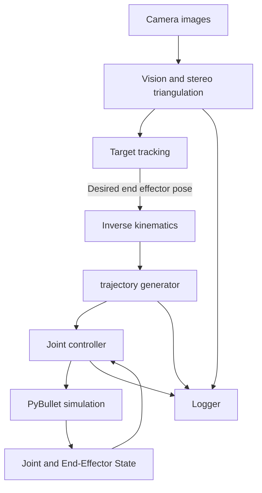

# System architecture 

## 7-Jointed Robotic Arm Simulation

**Document ID:** ARCH-001  
**Version:** 1.0  
**Status:** Approved   
**Project:** 7 Jointed Arm  
**System Type:** Robotic arm simulation and software verification

## 1. Purpose
 
The purpose of this project is to develop a 7 jointed robotic arm simulation that can demonstrate kinematics, computer stereo vision, trajectory generation and motion control. 

## 2. Scope

### 2.1 Included in scope

- 7 jointed arm model
- Simulated environment using PyBullet.
- Stereo vision and 3D target triangulation.
- Forward kinematics (FK).
- Inverse kinematics (IK).
- Joint trajectory generation.
- Joint level motion control.
- Target tracking.
- Data logging

### 2.2 Excluded from scope

- Physical robot hardware.
- Flight qualified software development.
- Spacecraft certification.
- Validation against actual Canadarm3 flight hardware or operational specifications.

# 3. Architecture 

The system is divided into subsystems in charged of the process to convert the target information obtained from a simulated camera into movement 
# 3.1 Data flow

1. The vision subsystem simulates a camera image and estimates the information of the target including it's 3D position 

2. The kinematics subsystem generates a joint configuration to reach that will reach the target

3. The trajectory subsystem generates joint references that depend on time 

4. The robot controller subsystem compares the desired joint states with the current joint states to calculate control commands

5. The simulation file applies the commands to the simulated environment and robot and advances the simulation.

6. The logging file records the resulting behavior for later review 

## 3.2 Diagram 

## 4. Subsystem architecture 

### 4.1 Main simulation 

**Main module:** `sim.py`

**Responsibilities:**
- Initialize the simulation.
- Load the canadarm model 
- Coordinate the execution of the other subsystems 
- Advance the simulation every loop 
- End the simulation

**Inputs:**
- Canadarm urdf model 

**Outputs:**
- Updated simulation state
- Joint measurements

### 4.2 Vision subsystem 

**Main module:** `Vision/opencv.py`

**Responsibilities**
- Generates camera simulation 
- Process camera images
- Estimate the target 3D position using stereo vision
- Calculate triangulation error

**Inputs**
- Camera calibration parameters
- Camera poses 

**Outputs:**
- Estimated target position
- Triangulation error 

### 4.3 Kinematic subsystem

**Main module**`Movement/kinematics.py`

**Responsibilities:**
- Calculate the end effector position and orientation from joint angles using forward kinematics
- Calculate joint configurations for a desired end effector pose using inverse kinematics
- Handle unreachable targets or unsuccessful IK solutions

**Inputs:**
- Joint angles
- Desired end effector pose
- joint constraints

**Outputs:**
- End effector position
- Joint angle solutions
- How many iterations it took to success

**NOTE:** Forward and inverse kinematics must be built without relying on pybullet's built in functions

### 4.4 Trajectory generation subsystem

**Main module:** `Movement/trajectory.py`

**Responsibilities:** 
- Generate a time dependent motion profile for each joint 
- Calculate joint position reference, velocity and acceleration 
- Respect joint position, velocity and acceleration limits
- Provide trajectory samples to the control loop in the correct order 

**Inputs:** 
- Initial joint configuration 
- Target joint configuration 
- joint limits
- Motion constraints 
- Time step for the trajectory 

**Outputs:**
- Joint position references
- Joint velocity references
- Joint acceleration references
- Trajectory timing information 

**Note:** The controller should execute the trajectory sample by sample without skipping samples

### 4.5 Control Subsystem 

**Main module:** `Movement/robot_controller.py` and `Utils/pid.py`

**Responsibilities:**
- Compare desired joint positions with the current joint positions
- Calculate joint control commands
- Respect joint limits 

**Inputs:**
- Desired joint positions and velocities
- Current joint positions and velocity
- Controller parameters

**Outputs:**
- Joint control commands

### 4.6 Logging module

**Main module:** `Utils/logger.py`

**Responsibilities:**
- Record relevant joint states, references, and calculates their error 
- record trajectory and kinematics results
- Support analysis of settling behavior, accuracy and failures
- record timestamps and joint identifiers 

**Inputs:**

- Joint state
- Desire joint angle
- Joint velocities
- Target 3D position

**Outputs:**
- graphs to analyze the behavior of the simulation 

### 5 Coordinate frames and units

Each implementation must be defined by using coordinate frames used by the camera, robot base, world and end effector

### 5.1 Coordinate frames

- **World frame:** The global frame used by the simulation.

- **Robot base frame:** The reference frame attached to the robot's base.

- **Camera frames:** The reference frames associated with the stereo cameras.

- **End-effector frame:** The reference frame attached to the last link.

### 5.2 Units

| Quantity | Unit |
|---|---|
| Position and link dimensions | Meters |
| Joint angles | Radians |
| Time | Seconds |
| Joint velocity | Radians per second |
| Joint acceleration | Radians per second squared |
| Angular velocity | Radians per second |
| Position error | Meters |
| Orientation error | Radians, where applicable |
## 6. Dependencies

| Dependency | Purpose |
|---|---|
| Python | Application and simulation logic |
| PyBullet | Physics simulation and visualization |
| OpenCV | Image processing and target detection |
| NumPy | Numerical computations |
| Pandas | Data analysis |
| matplotlib | Plot the logging files into graphs 

## 7. Design Constraints and Limitations

- The system is a simulation and does not work with physical hardware.
- FK and IK are implemented independently of PyBullet's built-in FK and IK functions.
- Robot geometry and simulated dynamics are simplified.
- Vision performance depends on simulated observation conditions.
- A successful simulation does not establish the actual Canadarm3 performance.

## 11. Related Documents

- `docs/system_requirements.md` — system capabilities and measurable requirements.
- `docs/requirements_traceability.csv` — links between requirements, implementation, and verification.
- `docs/verification_plan.md` — verification procedures and acceptance criteria.
- `docs/verification_report.md` — measured results and verification evidence.

## 12. Revision History

| Version | Date | Description |
|---|---|---|
| 1.0 | 2026-10-15 | Initial architecture document |